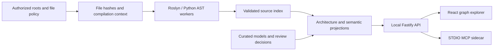

# Architecture Explorer

[English](README.md) | [简体中文](README.zh-CN.md)

**Explore a codebase from systems and business flows down to methods and source evidence.**

Architecture Explorer is a local architecture browser for C# and Python. It combines a curated responsibility model with static code analysis, so you can move between a system map, business explanations, call and data-access graphs, and the source that supports them.


*Actual application screenshot using the [included combat demo](examples/combat/README.en.md). The current application UI is Chinese; documentation is available in both languages.*

## What you can do

| Capability | What it gives you |
| --- | --- |
| **System → module → code** | Explore responsibilities, collaboration, ownership, and unclassified entities; drill down to real classes and methods. |
| **Business flow ↔ implementation** | Switch between a concise explanation, detailed steps, code, and a two-layer comparison. |
| **Calls, reads, writes, and impact** | Inspect a bounded graph around a symbol, filter relationships, and follow upstream or downstream dependencies. |
| **Source evidence** | Open the supporting lines, inspect the analysis rule and confidence, and reject evidence when its source hash has changed. |
| **C# and Python analysis** | Use Roslyn and Python AST workers without building or executing the target project. |
| **Live updates and review** | Watch source changes, retain the last valid index after failure, and maintain separately versioned models and human review decisions. |
| **Local STDIO MCP** | Query the same snapshots from Codex and navigate an explicitly authorized browser session. |


## Try the included demo

The supported bootstrap is **Windows x64 with PowerShell**. Install **Python 3.11+** first and make `python` available on PATH. Git is recommended for branch and Worktree metadata. Initial setup downloads the pinned Node.js, pnpm, .NET SDK, and dependencies; subsequent analysis runs locally.

From the repository root:

```powershell
./Tools/explorer.ps1 -Task Setup
./Tools/explorer.ps1 -Task Build
./Tools/explorer.ps1 -Task Dev -Config ./config/demo.json
```

Open **[http://127.0.0.1:4310](http://127.0.0.1:4310)**. The first scan indexes the six small demo source files. Try **系统总览 → 战斗调度**, **业务流程 → 双层对照**, or search for **Health** and choose **数据读写**.

The [demo](examples/combat/README.en.md) includes its own source, architecture model, and semantic definitions. It runs without Unity or any external project. Setup creates `config/local.json` only when missing; the demo command explicitly uses `config/demo.json`. Keep using `-Config` when running that demo.

## Analyze your project

Create a local configuration from [config/projects.example.json](config/projects.example.json), then set the authorized root, include/exclude rules, and any C# metadata references. Paths are relative to the configuration file.

```powershell
Copy-Item ./config/projects.example.json ./config/my-project.local.json
# Edit config/my-project.local.json before starting.
./Tools/explorer.ps1 -Task Dev -Config ./config/my-project.local.json
```

Keep private configuration out of Git. `config/local.json`, `config/*.local.json`, and `.env` variants are ignored by default; only `.env.example` is allowed as a shared template. Add any other private filename to your local Git exclude rules. Alternatively, set `EXPLORER_CONFIG`.

For Unity projects, Setup can populate explicit Unity metadata references:

```powershell
./Tools/explorer.ps1 -Task Setup -ProjectRoot 'C:/src/MyGame' -ProjectName MyGame -ProjectId my-game -UnityEditorPath 'C:/Program Files/Unity/Hub/Editor/<version>'
```

This initializes a missing `config/local.json`; it does not replace an existing one. A project without a curated model still supports technical architecture and code exploration. Add models under `architecture/models/<project-id>/` and explanations under `architecture/semantics/<project-id>/`.

Optional [content packages and acceptance stories](docs/en/CONTENT-PACKS.md) customize explanations and evidence checks using explicit JSON files. They use the current project's model and index, without built-in project names, source files, or domain symbols.

See the [system guide](docs/en/SYSTEM-ARCHITECTURE.md), [semantic guide](docs/en/SEMANTIC-GUIDE.md), and [MCP guide](docs/en/MCP-GUIDE.md) for the full workflow.

## How it works



The implementation uses React, React Flow, ELK, Fastify, TypeScript, Roslyn, and Python's standard library. Packages separate facts, projections, evidence auditing, and the browser-control protocol. See the [architecture notes](docs/en/ARCHITECTURE.md).

## Development and checks

```powershell
./Tools/explorer.ps1 -Task Web        # Frontend at 5173; API uses the selected config port
./Tools/explorer.ps1 -Task Typecheck
./Tools/explorer.ps1 -Task Test
./Tools/explorer.ps1 -Task Build
./Tools/explorer.ps1 -Task Scan -Config ./config/demo.json -Project combat-demo
./Tools/explorer.ps1 -Task Verify -Config ./config/demo.json -Project combat-demo
./Tools/explorer.ps1 -Task Audit -Config ./config/demo.json -Project combat-demo
```

`Dev` serves the built website and API; `Web` is the separate frontend development server. After changes, rebuild before using `Dev`. `Start-Explorer.cmd` starts the configured local project after setup/build. Stop the web service before a separate CLI scan of the same scope to avoid cache-lock contention.

The [layered CI](docs/en/CI.md) runs fast static/unit checks on Linux, real analyzer and integration checks on Windows, and web component tests plus a production build on Linux. A stable **CI gate** checks every selected layer. [All documentation](docs/en/README.md) includes current guides and clearly dated historical validation records.

## Trust and current limits

For repository contributions, use the optional [dedicated GitHub App commands](docs/en/DEV-APP-SETUP.md) to push a task branch and open a bot-authored PR. Human maintainers approve the final bot push and merge after CI; authentication failures never fall back to personal credentials.

- Target source stays local. The tool reads explicitly configured roots, writes its own cache/models, and does not execute target Python modules or build the target C# project.
- Static confirmation means an analyzer resolved a source relationship. It does not establish runtime execution, virtual dispatch targets, or complete data flow.
- Business ownership and explanations are curated candidates until reviewed. Human confirmation does not upgrade the underlying evidence.
- Current incremental analysis reuses AST/SyntaxTree data and unchanged language results. Scans still hash the authorized file inventory twice; symbol-level invalidation is not implemented.
- C# currently uses a merged compilation context. Per-assembly Unity build fidelity, complete alias/return propagation, automatic cross-language protocol mapping, and runtime tracing remain outside the supported scope.
- The Windows bootstrap is the supported installation path. Linux CI validates selected portable components; it is not a claim of a supported cross-platform installer.

The [readiness review](docs/en/OPEN-SOURCE-REVIEW.md) records the findings and their repair status. [Publication privacy](docs/en/PUBLICATION.md) documents private-project dependencies and the anonymous release snapshot.

## License

This project is **source-available under [PolyForm Noncommercial 1.0.0](LICENSE)**: permitted noncommercial use, modification, and distribution are free. Commercial purposes outside those permissions require a separate written license. This is not an OSI open-source license. See [licensing](docs/en/LICENSING.md) and [NOTICE](NOTICE); third-party dependencies retain their own licenses.
