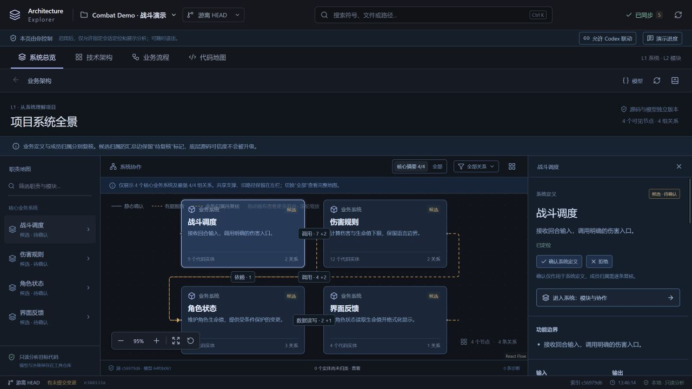
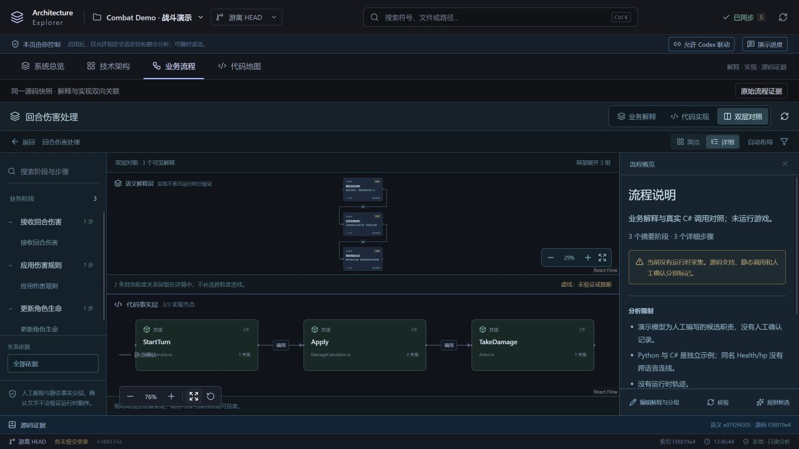
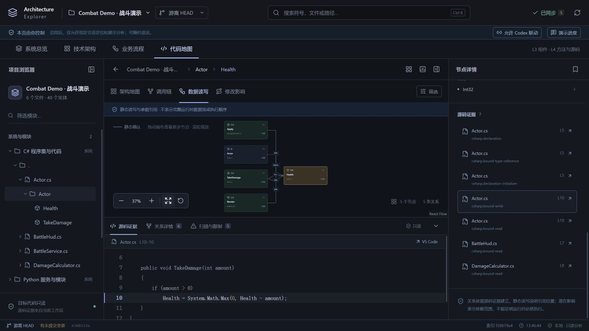
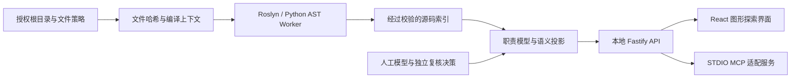

# Architecture Explorer

[English](README.md) | [简体中文](README.zh-CN.md)

**从系统职责和业务流程，一路探索到方法、调用与源码证据。**

Architecture Explorer 是本地运行的 C#/Python 架构探索工具。它把人工维护的职责模型与静态分析结合起来，让系统地图、业务解释、调用与读写关系，以及支撑它们的源码可以相互定位。



*真实应用截图，使用仓库内的[战斗演示项目](examples/combat/README.md)。当前产品界面为中文，文档提供中英双语。*

## 主要功能

| 功能 | 可以解决什么问题 |
| --- | --- |
| **系统 → 模块 → 代码** | 理解职责、协作与归属，逐层进入真实类和方法；无法分类的实体明确保留。 |
| **业务流程 ↔ 实现** | 在简洁解释、详细步骤、代码实现和双层对照之间切换。 |
| **调用、读写与影响分析** | 围绕符号查询有限邻域，筛选关系，查看上游、下游与潜在修改影响。 |
| **源码证据** | 查看对应行、分析规则与可信度；源码哈希变化后拒绝沿用旧证据。 |
| **C#/Python 静态分析** | 通过 Roslyn 和 Python AST 解析源码，不构建或执行被分析项目。 |
| **监听与人工复核** | 源码变化后更新索引，失败时保留最后有效结果；模型与复核决策独立版本化。 |
| **本地 STDIO MCP** | Codex 查询同一快照，并在网页明确允许后定位和展示分析。 |





## 先体验演示

当前支持的准备入口为 **Windows x64 + PowerShell**。先安装 **Python 3.11+**，确保 PATH 中可以运行 `python`。推荐安装 Git，以显示分支与 Worktree 信息。首次准备会下载锁定的 Node.js、pnpm、.NET SDK 和依赖，分析过程在本地完成。

在仓库根目录运行：

```powershell
./Tools/explorer.ps1 -Task Setup
./Tools/explorer.ps1 -Task Build
./Tools/explorer.ps1 -Task Dev -Config ./config/demo.json
```

打开 **[http://127.0.0.1:4310](http://127.0.0.1:4310)**。首次扫描只读取六个小型演示源码文件。可以尝试 **系统总览 → 战斗调度**、**业务流程 → 双层对照**，或搜索 **Health** 后选择 **数据读写**。

[演示](examples/combat/README.md)自带源码、职责模型和语义定义，无需 Unity 或任何外部项目。Setup 仅在缺失时创建 `config/local.json`；上述演示命令明确使用 `config/demo.json`，后续启动演示时也需保留 `-Config`。

## 分析自己的项目

复制 [config/projects.example.json](config/projects.example.json)，设置明确授权的项目根目录、include/exclude 规则，以及需要的 C# 程序集元数据引用。配置中的相对路径以配置文件目录为基准。

```powershell
Copy-Item ./config/projects.example.json ./config/my-project.local.json
# 编辑 config/my-project.local.json 后再启动。
./Tools/explorer.ps1 -Task Dev -Config ./config/my-project.local.json
```

不要提交私人配置。默认忽略 `config/local.json`、`config/*.local.json` 与 `.env` 变体，仅保留 `.env.example` 作为共享模板；其他私人文件名请加入本机 Git exclude 规则。也可通过 `EXPLORER_CONFIG` 指定配置文件。

Unity 项目可以让 Setup 填充明确的 Unity 元数据引用：

```powershell
./Tools/explorer.ps1 -Task Setup -ProjectRoot 'C:/src/MyGame' -ProjectName MyGame -ProjectId my-game -UnityEditorPath 'C:/Program Files/Unity/Hub/Editor/<version>'
```

这只初始化缺失的 `config/local.json`，不会替换已有配置。没有人工模型的项目仍可使用技术架构与代码地图；职责模型放在 `architecture/models/<项目ID>/`，业务解释放在 `architecture/semantics/<项目ID>/`。

可选的[内容包与验收故事](docs/CONTENT-PACKS.md)通过显式 JSON 文件定制解释和证据检查，使用当前项目的模型与索引，无内置项目名称、源码文件或领域符号。

完整流程见[系统指南](docs/SYSTEM-ARCHITECTURE.md)、[语义图指南](docs/SEMANTIC-GUIDE.md)和[MCP 指南](docs/MCP-GUIDE.md)。

## 架构概览



实现使用 React、React Flow、ELK、Fastify、TypeScript、Roslyn 与 Python 标准库。源码事实、投影、证据审计和网页联动协议分包维护，详见[架构说明](docs/ARCHITECTURE.md)。

## 开发与验证

```powershell
./Tools/explorer.ps1 -Task Web        # 前端5173，API代理使用所选配置端口
./Tools/explorer.ps1 -Task Typecheck
./Tools/explorer.ps1 -Task Test
./Tools/explorer.ps1 -Task Build
./Tools/explorer.ps1 -Task Scan -Config ./config/demo.json -Project combat-demo
./Tools/explorer.ps1 -Task Verify -Config ./config/demo.json -Project combat-demo
./Tools/explorer.ps1 -Task Audit -Config ./config/demo.json -Project combat-demo
```

`Dev` 提供构建后的网页与 API，`Web` 是独立前端开发服务。修改前端后需重新 Build 再通过 Dev 查看；完成准备与构建后，`Start-Explorer.cmd` 可启动已配置的本机项目。独立 CLI 扫描同一作用域前，应先停止网站服务，避免争用缓存锁。

[分层 CI](docs/CI.md)包括 Linux 快速静态与单元检查、Windows 真实分析器及集成测试、Linux 前端组件与生产构建；稳定的 **CI gate** 汇总所选层的结果。[文档目录](docs/README.md)区分当前指南和带日期的历史验收。

## 可信度与当前边界

- 目标源码保留在本机；工具只读取明确授权根目录，缓存与模型写在工具目录，不执行目标 Python 模块或构建目标 C# 项目。
- “静态确认”表示分析器解析了源关系，不证明运行时执行、虚调用实际目标或完整数据流。
- 人工归属与解释在复核前为候选；确认文字不会升级底层证据可信度。
- 增量分析复用 AST/SyntaxTree 与未变化语言结果，但每次扫描仍两次核对授权文件清单哈希，尚无符号级失效机制。
- C# 当前使用合并编译上下文，尚不支持逐程序集 Unity 构建等价性、完整别名/返回值传播、自动跨语言协议映射和运行时追踪。
- 当前支持 Windows 准备入口；Linux CI 验证部分可移植组件，不表示已提供跨平台安装程序。

[发布准备审查](docs/OPEN-SOURCE-REVIEW.md)记录问题及修复状态；[发布隐私与依赖审计](docs/PUBLICATION.md)说明特定项目依赖和匿名发布副本。

## 许可证

本项目采用 **[PolyForm Noncommercial 1.0.0](LICENSE)**，属于源码可见（source-available）：允许目的内的非商业使用、修改和分发免费，超出这些允许目的的商业用途需单独取得书面许可。它不属于 OSI 定义的开源许可。详见[许可说明](docs/LICENSING.md)与 [NOTICE](NOTICE)；第三方依赖保留各自许可。
