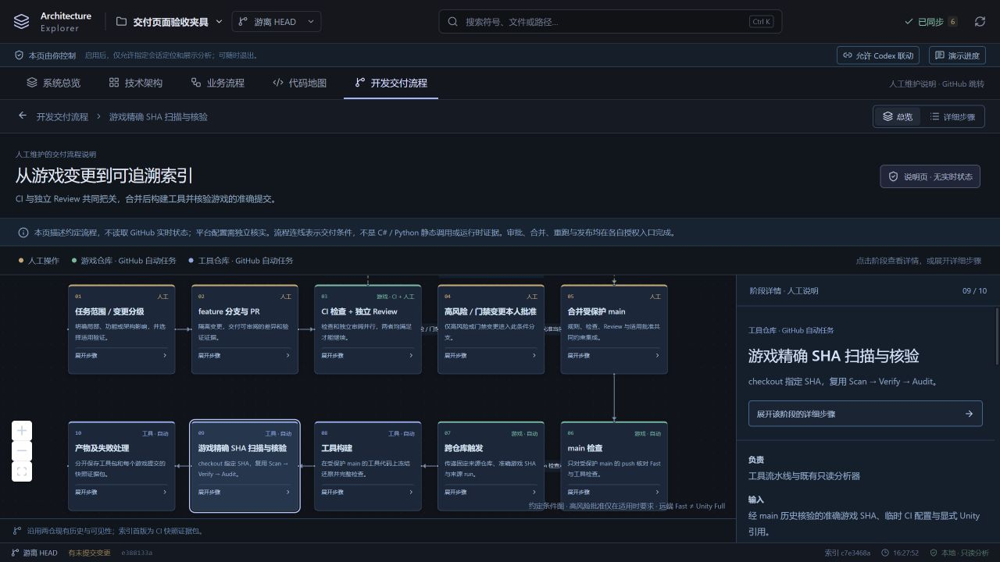
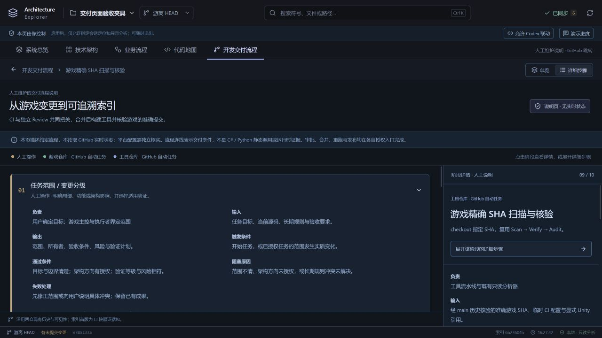

# 开发交付接收端本地验收

日期：2026-10-21，America/Toronto。初始实现提交：`30407a794f9bb8a5a93854f12277c306b741be40`；本轮收尾实现提交：`1d7c4fa5d5154bb73ce83eeee770a5c486411d56`，分支 `codex/github-game-delivery`。

本轮完成工具侧实现、七字符串接口核对、本地独立提交与证据。**接收端尚未远端就绪**：没有推送、合并、创建凭据、配置 GitHub 或发送正式请求。统一回交材料为 [receiver-handoff-v1.txt](ReviewEvidence/receiver-handoff-v1.txt)。

## 实际执行

| 检查 | 结果 | 证据 |
| --- | --- | --- |
| 锁定环境准备 | 冻结 pnpm 还原、供应链策略验证、锁定 SDK worker 构建成功；未生成本机配置 | `Tools/ci-check.ps1 -Prepare` 的本地执行，`.tools` 为工具侧运行目录 |
| 最终 Typecheck / 全套测试 | Typecheck 成功；296/296 通过，0 失败、0 跳过 | [JUnit](evidence/delivery/local-junit.xml)、[检查摘要](evidence/delivery/local-checks.json)；完整控制台日志在工具侧 `test-results/` |
| 前端与 C# 构建 | Vite 成功；.NET SDK 10.0.402，worker 0 warning / 0 error | `test-results/frontend-build.txt`、`test-results/csharp-build.txt` |
| 工作流与脚本 | actionlint 1.7.12 校验两份工作流成功；PowerShell Parser 校验成功；官方 Actions 标签解析后固定为提交 SHA | `.github/workflows/`、`docs/DEVELOPMENT-DELIVERY.md` |
| 发送 / 接收合同 | 参考发送脚本经无网络夹具产生精确七个 string 输入，实际 workflow env 映射可同时通过授权与快照输入校验；请求回执仍为 `not-observed` | `tests/ci-contract.test.ts`，纳入 296 项 |
| 授权边界 | 非法仓库/ref/版本/SHA/run/attempt、无保护、缺必需检查、API 失败、错误合并 PR、自审/bot/旧 head/撤销/合并后补审均拒绝；聚合全部有效 Ruleset，真实独立批准人数须达到有效门限 | `tests/ci-authorize.test.ts`，纳入 296 项 |
| 索引边界 | Git 读取失败、空 HEAD、索引 SHA 不符、非 main、隐藏源文件变化、Unity 引用缺失/不匹配拒绝；真实 Scan/Verify/Audit 夹具保留待复核和人工文字 | `tests/ci-snapshot.test.ts`，纳入 296 项 |
| 引用 ZIP | 精确摘要、固定 HTTPS、不跟随跳转、根文件白名单，路径穿越、目录、链接、重名及错误摘要均拒绝；过期签名 URL 不进入错误诊断 | `tests/ci-references.test.ts`，纳入 296 项；测试字节从未用作 Unity 分析引用 |
| 工具所有权与访问门禁 | CODEOWNERS 覆盖敏感边界而不扩大到所有普通 UI；PR 无生产凭据，main 工具包须私有仓库与人工读者范围批准；来源授权失败不上传带引文工具包 | `tests/codeowners.test.ts`、`tests/ci-artifact-access.test.ts` |
| 包验证目录边界 | 创建前拒绝祖先 junction；删除前复核真实路径、目录身份及随机所有权；不删 base 或已替换路径，保留 junction 目标 | `tests/ci-smoke-directories.test.ts`，4 项实际通过，无跳过 |
| 完整工具包 | 包内 Node + tsx 实际启动后端，前端 HTTP 200，项目/图 API，真实 C#/Python 夹具分析 12 nodes / 5 edges / 2 files；17 个根依赖均在包内解析 | [本地包启动证据](evidence/delivery/package-smoke.json) |
| 页面 | 实际打开 `http://127.0.0.1:4311/?page=delivery`，总览、详情展开、阶段返回和 PR 外链目标正确；界面使用仓库夹具 | 下方截图与 `apps/web/src/delivery.test.ts` |

本机 Python 为 3.14.3；CI 固定 3.13.7。锁定的远端 Windows runner 与该 Python 版本组合尚未实际运行，不能用本机结果代替。前端保留既有 React Flow / Lucide `use client` 与大 chunk 警告，未修改门限掩盖警告。

首次沙箱执行因 loopback / junction 权限失败；完整本地权限重跑全部通过。干净环境另暴露语义存储测试夹具未建立 `.cache` 父目录，已在该夹具补建，未删除测试或减弱断言。CI 还会在任何必需测试跳过时失败。

独立审阅发现普通 `COMMENTED` 不应撤销已有批准，已修复并补测；继续要求准确 head、独立真实 User、合并前批准。包实际启动发现直接复制 pnpm 链接会破坏 tsx/esbuild 依赖，已改为隔离 staging 的离线冻结 hoisted 复制还原，无包内链接，并实际运行 esbuild 和完整包。

本轮包启动证据中的 `packageId` 是本地测试目录标识，`execution=local-check`、`runUrl=null`、`sourceDirty=true`，打包时 HEAD 为 `74a2f532c5dcb3b75b7477a2a13ac2f4e71eea06`，不是远端提交产物或干净提交包。初轮“不含游戏源码”的描述错误，现予更正：包未带完整游戏 checkout、本机配置、Git 凭据、Unity DLL 或缓存，但保留人工模型/锚点/文档中的游戏源码摘录；`model.json` 的 236 个锚点都有引文。工具仓库、日志、报告及两类产物须按游戏访问范围审核。新包的清单和 RUNNING.md 明确披露摘录，真实启动测试核实引文及人工模型字节保留。包仍需 Git、Python 与 .NET 运行环境及本机配置，不是安装器。

本轮本地子代理审阅发现并关闭：临时目录 junction/清理边界、多个 Ruleset 聚合顺序、实际审批人数不足门限三项问题。子代理审阅不替代 GitHub 上独立 Code Owner 的真实批准。Unity 仅交付[供应方案](UNITY-REFERENCE-SUPPLY.md)，尚无生产 DLL/ZIP、许可确认或长期续期方案。上述收尾时开发 App 尚未创建；后续已创建并完成本页末尾的只读认证验证，[App 清单](DEV-APP-SETUP.md)已同步真实身份与结果。Git/PR 写入认证仍未实现。

## 界面证据

PR 链接实际打开固定的 `https://github.com/chwan886/GameDemo02/pulls`。内置浏览器当时未登录，私有仓库显示 GitHub 404 / Sign in；这证明目标跳转，不能据此声称已浏览私有 PR 内容。仓库访问另以原有 Git 认证的只读 API 核实，工具页面没有接收该认证。

## 尚未执行

- 本轮工作流未进入工具 main，远端 CI、workflow_dispatch 和 artifact 上传未运行，真实链接均无。
- 未使用生产游戏 SHA 扫描；没有借用本机 Unity DLL 或伪造 Unity 类型。真实引用供应及 fingerprint 待配置。
- 两仓 main 保护、独立 Review / Code Owner 门禁、两个受保护 Environment、开发 App 与独立的生产发送/读取 App、产物读者集合及开关仍需人工配置/核实。开发 App 只限 Contents/Pull requests/Workflows write、无 Administration、无 main bypass；未退回 Owner 身份推送。
- 游戏第一阶段仅按用户转交文档核对，未重读或修改游戏实现；其本地 349 项结果属于游戏主控报告，不是本工具执行的检查。
- 未运行 Unity Full / Release、真实 feature 合并或端到端联调；不以 Fast、夹具或 HTTP 请求接受冒充。

正式启用按 [交付合同的六步顺序](DEVELOPMENT-DELIVERY.md#首次接入顺序)继续；缺项未补齐时开关保持关闭。

## 后续开发 App 只读认证验证

用户创建 App 后，本轮仅授权本机认证验证。入口为 `Tools/dev-app-auth.ps1 -Verify`，实际过程及绝对命令见 [DEV-APP-SETUP.md](DEV-APP-SETUP.md)。App ID `5417611`、Client ID `Iv23lil3cvGyWUbx4yfS`、slug `chwan-dev-agent`、Installation ID `173913073` 均经真实 App JWT API 核实。

最终 `Tools/ci-check.ps1`：**321/321 通过，0 失败、0 跳过**，包含新增 14 项认证核心与 11 项实际 Windows ACL/link 测试；Typecheck、Vite、C# worker 均成功。独立子代理复核指出的未知签发状态、撤销异常路径和探测测试断言问题均已修正。新版完整 JUnit 与摘要独立保存在 [dev-app/full-junit.xml](evidence/dev-app/full-junit.xml)、[dev-app/local-checks.json](evidence/dev-app/local-checks.json)，此前 296 项交付验收证据不改写。

真实只读认证共两次，均只申请 `Architecture-Explorer` Contents read（服务端另含隐含 Metadata read），没有 GameDemo02 或 installation 全范围 token。首次在 DELETE 204 后即时探测未确认，保持 [failed 回执](evidence/dev-app/auth-verification-2026-10-21.json)。增加状态记录及有界只读探测后，[第二次 passed 回执](evidence/dev-app/auth-verification-2026-10-21-attempt2.json)证实权限、单仓可见范围、准确 main ref 实读、DELETE 204，以及同一原 token 最终 401。200、200、200、401 的实测序列完整保存，不能据此编造官方传播时间或缓存原因。

私钥目录/文件 ACL 只允许当前用户、SYSTEM、Administrators；受限继承与 owner Administrators 均明确记录，路径链不含链接。未更改真实权限。只在认证 Node 内存读取 PEM、签 JWT、持有 IAT；不输出/持久化这些秘密，不使用 Owner 或全局 Git/CLI 登录，生产 CI 不取得此 App 凭据。

仍待完成：安装恰好两仓的人工 UI 证据，Git/PR 写入认证入口、main/Environment/生产 App 与真实接收端验证。JWT 两仓正向 membership 和窄权 token 不能证明安装没有第三仓。本轮未推送、未建 PR、未合并、未 dispatch、未启用自动发送；接收端继续 `REMOTE_NOT_READY`。
